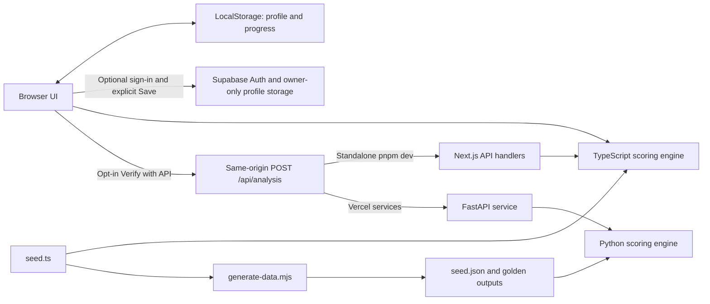

# Pivott

**Don't predict the job. Map the tasks. Route the skills.**

Pivott helps people examine how AI could affect the tasks in their working week, identify adjacent roles that reuse their skills, and build a practical learning pathway. It uses deterministic formulas and a versioned illustrative dataset—no LLM scoring. Guest profiles and progress stay in your browser. Optional Supabase email-link sign-in enables explicit account saving; it requires project configuration and the included database migration. An optional **Verify with API** check compares local results with a stateless backend using task/skill inputs, without sending your display name or progress.

**[Live demo](https://pivottstudio.vercel.app)** · [Design direction](pivott-web-application-design/DESIGN.md) · [Vercel setup](VERCEL.md) · [English demo script](backend/docs/demo-script.en.md)


## How it fits together



The website is served by Next.js. Under Vercel services, `/api/*` goes to FastAPI; all other paths go to Next.js. There are no server-to-server service calls, so no internal service bindings are needed. See [architecture in English](backend/docs/architecture.en.md) or [中文架构](backend/docs/architecture.md).

## Run locally

Use Node.js 24 and pnpm 12.3.4 (pinned in the frontend package). For the standalone website, from the repository root:

```bash
cd pivott-web-application-design
npx --yes pnpm@12.3.4 install --frozen-lockfile
npx --yes pnpm@12.3.4 dev
```

Open the local address printed by Next.js. This mode includes the Next.js API implementation, so it needs no separate backend.

For both services, also use Python 3.12 and prepare the backend from the repository root:

```bash
python -m venv backend/.venv
backend/.venv/bin/python -m pip install -r backend/requirements.txt
npx --yes --package=pnpm@12.3.4 --package=vercel@65.1.0 vercel dev --local
```

On Windows, use `backend\.venv\Scripts\python.exe` instead. The combined runner starts both services. Use its printed `localhost` address; unconfigured host aliases can be blocked by Next.js's development-origin checks. The Vercel project Root Directory must be the repository root. Full details are in [VERCEL.md](VERCEL.md).

## Verify

Run the following from the repository root:

```bash
(cd pivott-web-application-design && pnpm test && pnpm exec tsc --noEmit --incremental false && pnpm build)
(cd backend && .venv/bin/python -m pytest -q)
node scripts/generate-data.mjs --check
node scripts/demo-rankings.mjs
```

Use pnpm 12.3.4 on PATH (or substitute `npx --yes pnpm@12.3.4` for `pnpm`). Windows users can run the commands in each directory individually.

With `vercel dev` running, check the combined router (replace the origin if you chose another port):

```bash
python scripts/smoke_vercel.py http://localhost:3000
```

In the app, load **View an example**, open the map, and click **Verify with API**. Expect `Matches API: 6/6 tasks, role exposure matches, route order identical.` Repeat in Fast, then add a signal under Signals → Admin, recompute the map, and verify again. A network error leaves the local results usable. Verification is opt-in and sends task/skill inputs, custom tasks, and applied custom signals; the application does not store those request inputs.

Normal ranks **Operations Coordinator** first for Aisyah; Fast ranks **Finance Systems Analyst** first. The landing illustration derives its Normal destination from the engine. Following the default Normal route gives 4 learning steps, 48 estimated hours, and 8 weeks at the default 6 hours/week. Selecting another role intentionally changes the destination.

Frontend and backend checks run in [.github/workflows](.github/workflows). The optional browser scripts `scripts/check-personal-browser.cjs` and `scripts/check-account-browser.cjs` use externally installed Playwright (set `PLAYWRIGHT_MODULE` and `PIVOTT_TEST_ORIGIN`; optionally `PIVOTT_CHROMIUM_EXECUTABLE`). The personal check writes screenshots under `docs/` or `PIVOTT_SCREENSHOT_DIR`; run it against guest-mode Next.js or combined Vercel services. The account check uses synthetic Supabase responses; see [its setup](supabase/README.md).

The current suites cover formulas, the demo workflow, every skill's free-resource coverage, custom-input validation, cross-language goldens, API errors, and CORS.

## Résumé import

Start with a PDF or DOCX résumé to review local catalogue suggestions before changing your profile. Files are read in the browser; extracted text is discarded and new skills stay unrated. Manual setup remains available. See [supported files, privacy and tests](docs/resume-import.md).

## Personal workflow and account saving

Choose a reference role, confirm its tasks, then view the initial map before rating skills. A personal job title and task names do not change the template's illustrative scores. Time edits rebalance to 100%; task removal has Undo, and restoring defaults requires confirmation. Custom tasks remain **Not assessed yet**, including older custom tasks with numeric assumptions. Exposure is conditional on assessed reference tasks, with the assessed share shown separately.

**Not sure** is distinct from level 0 (**No experience**). Unanswered skills are excluded from coverage and learning gaps. With no rated requirements, provisional ranking uses task similarity and target exposure; partial ratings and learning estimates are labeled. Users can save up to three routes and resume one active profile/plan at `/workspace`.

Accounts are optional. Follow [Supabase setup](supabase/README.md) to apply owner-only RLS and configure public build variables and email callbacks. Saving is explicit, conflicts require a choice, and stale revisions cannot overwrite another device silently. Account settings live at `/account`. No service-role key is used by the frontend.

## Data and maintenance

The dataset has 6 roles, 31 tasks, 15 skills, 20 dated signals, 4 SDGs, 25 resources, and 2 scenarios. Every skill has at least one free resource. The data cut-off remains 1 October 2026; seed version is `2026.10.2`.

Edit `pivott-web-application-design/lib/data/seed.ts` and regenerate `backend/app/data/seed.json` and `backend/tests/golden.json` with:

```bash
node scripts/generate-data.mjs
```

Do not hand-edit the JSON. Formula changes must be mirrored in both engines, followed by regeneration and both test suites. [Backend documentation](backend/docs/README.md) includes English and Chinese guides.

## Limits and privacy

- Exposure measures potential task assistance or automation; it is **not a probability of job loss**. Base scores and role mappings are illustrative editorial inputs, not measured labour-market forecasts.
- The six roles are a small demo catalogue. Published signal references do not independently validate the assigned task scores. No live job/news feed or LLM is used.
- Learning durations are estimates; course availability, pricing, and external links can change.
- Guest work stays in this browser. With configured Supabase, **Save to account** explicitly uploads the profile, skills, selected tasks, saved routes, signals and plan progress. Signing in never automatically replaces or merges guest ratings. See [account setup and policies](supabase/README.md). Verification sends inputs only when clicked. Local calculation keeps working if verification fails; offline page reloads are not guaranteed because this is not a PWA.
- The public API has no authentication or application rate limiter. Apply hosting-edge abuse controls before wider use. CORS is restricted to explicit origins and is not an authentication or rate-limit mechanism.
- The passport is a personal planning summary, not a qualification or verifiable credential.

The live address was confirmed by the project owner; direct live-site requests are blocked from the development environment. Automated checks here validate local builds and the combined services router, not the current production deployment.
