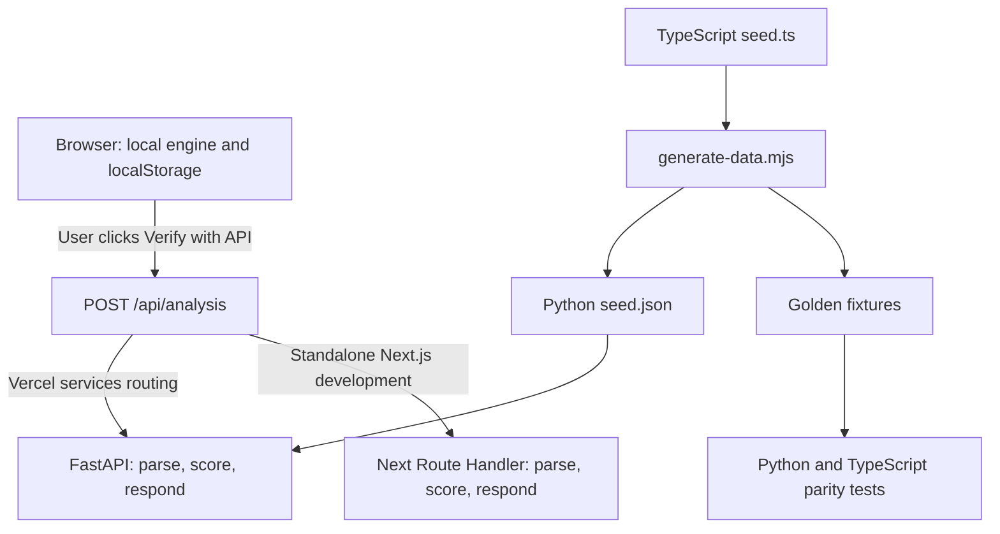

# Pivott architecture

[中文版本](architecture.md) · [Demo script](demo-script.en.md) · [Verification checklist (中文)](verification.md)

## Purpose and boundaries

Pivott maps a job to tasks, calculates task-level AI exposure, ranks adjacent roles by existing skill coverage and target exposure, and schedules learning steps for the gaps. It does not predict unemployment, train or call an LLM, scrape live labour-market data, or implement accounts, hiring, payments, or a database.

The browser's TypeScript engine remains the main interactive workflow. Profiles, display names, selected tasks, custom signals, and learning progress are saved in localStorage. Aisyah's demo is kept separately from a personal profile. The backend is stateless and is not required for local scoring.

## Components and request flow

| Component | Responsibility |
| --- | --- |
| `pivott-web-application-design/lib/engine.ts` | Deterministic browser and Next.js scoring |
| `pivott-web-application-design/lib/store.ts` | Local state, active signals, selected/custom tasks, demo isolation |
| `pivott-web-application-design/lib/remote.ts` | Opt-in, same-origin API request and parity comparison |
| `pivott-web-application-design/app/api/*` | Standalone Next.js API implementation |
| `backend/app/main.py` | FastAPI application, routing and CORS |
| `backend/app/parsing.py` | Request validation, custom-input clamps, opaque pathway IDs |
| `backend/app/engine.py` | Python port of the deterministic scoring engine |
| `backend/app/seed.py` | Loads exported JSON and builds lookup tables |
| `scripts/generate-data.mjs` | Exports TypeScript seed and golden outputs |
| `backend/tests/golden.json` | Expected outputs generated by the TypeScript engine |

In the combined Vercel project, the root rewrite sends `/api/*` to FastAPI and everything else to Next.js. No server-to-server call exists, so no service binding is required. The browser's API request is same-origin. The local `vercel dev --local` runner starts both services; plain `pnpm dev` starts only the Next.js implementation.

## Data and calculations

Seed version `2026.10.2` has a data cut-off of 1 October 2026: 6 roles, 31 tasks, 15 skills, 20 dated signals, 4 SDGs, 25 learning resources, and 2 scenarios. Every skill has a free resource. Aisyah is a Finance Admin; her default browser demo uses Normal and 6 hours/week. API examples also use 8 hours/week explicitly.

Core formulas, implemented in both engines:

- Recency: `0.5 ** (age_days / 180)`.
- Signal adjustment: weighted sum of strength, direction, recency and impact, clamped to ±0.2.
- Task exposure: `clamp(base_exposure * scenario_multiplier + adjustment, 0, 1)`.
- Role exposure: sum of normalized time share multiplied by task exposure.
- Classification: Automate for exposure ≥0.65 and human judgment <0.4; Protect for judgment ≥0.65; otherwise Augment.
- Coverage: importance-weighted current/required skill levels, capped at 1 per skill.
- Fit: `100 * (0.8 * coverage + 0.2 * task_similarity)`; coverage alone if similarity is unavailable.
- Gap hours: missing skill levels multiplied by the seed's hours per level; weeks are the ceiling of total hours divided by weekly hours.
- Route score: `0.7 * fit + 0.3 * 100 * (1 - target_exposure)`.

Normal ranks Operations Coordinator first for the demo. Fast ranks Finance Systems Analyst first. These are scenario outcomes, not promises of a job or a measured risk forecast.

## Validation and verification

`POST /api/analysis` accepts role, selections, skills, scenario, weekly hours, free-only preference, and optional custom tasks and applied custom signals. Both APIs reject invalid custom IDs, seed overrides, duplicate IDs, bad dates, non-HTTPS links, unknown affected tasks and non-finite scores. They clamp scores to the editor's ranges, and custom evidence is always `user`.

The browser check compares task exposures, weighted role exposure, and ordered route IDs with a numerical tolerance of `1e-9`. It does not send the display name, completion history, cookies, or pending custom signals. The application does not persist the request. A failed request does not replace local results or prevent continued use. Changing input invalidates an earlier verification result.

`POST /api/profiles` validates and echoes inputs; it does not create a stored account. Pathway IDs encode inputs so `GET /api/pathways/{id}` can rebuild a pathway; they are not confidential credentials.

## Tests, CI and maintenance

The root `.github/workflows/backend-tests.yml` runs backend pytest checks. `.github/workflows/frontend.yml` installs frozen dependencies, runs Vitest and TypeScript, and builds Next.js. Locally, also run `node scripts/generate-data.mjs --check` and the combined-router smoke script documented in `VERCEL.md`.

Never hand-edit the backend seed or golden fixtures. Update `seed.ts`, mirror any formula change in both engines, run `node scripts/generate-data.mjs`, and run both suites. Current goldens cover Normal/Fast analysis, custom inputs in both scenarios, Finance Admin tasks, and paid/free pathways.

## Deployment, privacy and limitations

CORS defaults to the deployed site and localhost; override via explicit comma-separated `PIVOTT_CORS_ORIGINS` when necessary. Same-origin requests in the Vercel deployment do not need additional CORS origins. The public deployment exposes `/api/*`, not FastAPI's `/docs`, `/redoc`, `/openapi.json` or `/` routes. Standalone FastAPI offers the documentation locally.

No authentication, database, server-side profile store or application rate limiter exists. Apply hosting-edge abuse controls before wider public use; CORS is not authentication or rate limiting. Do not log request bodies. Custom signals are browser-local and are sent only for the requested verification, not published as a shared feed. Exposure values and role/SDG mappings remain illustrative; verified references support signals, not the editorial base scores themselves.
