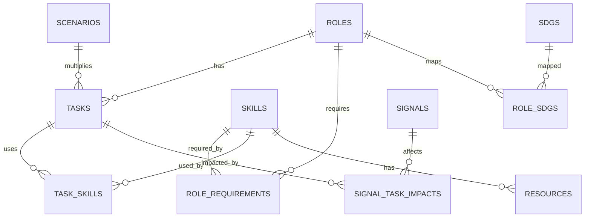
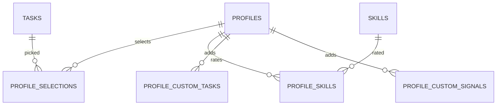

# Pivott 数据模型（与前端 demo 对齐）

> **事实来源**：前端 demo 的 `lib/data/seed.ts`（目录与种子）、`lib/engine.ts`（派生公式）、`app/api/*`（HTTP 契约）。
> 本文的数字全部由 seed 直接统计，示例分数用同一套公式复算，和 demo 页面显示一致。
>
> **状态**：已实现。`app/models.py`、`app/seed_data.py`、`app/seed.py`、`supabase/schema.sql` 都按本文落地；旧 TaskShift 字段已删除。第 9 节保留迁移对照，方便审阅。

## 1. 规模总览

| 实体 | 数量 | 说明 |
|---|---:|---|
| Role | 6 | Finance Admin、Finance Systems Analyst、Data Analyst、Marketing Executive、Customer Support Specialist、Operations Coordinator |
| Task | 31 | Finance Admin 6 个，其余 5 个角色各 5 个 |
| Skill | 15 | 4 个类别：Technical 7、Analytical 3、Communication 3、Operational 2 |
| RoleRequirement | 36 | 角色—技能要求，带 `requiredLevel` 和 `importance` |
| TaskSkill | 73 | 31 个任务的技能链接总数（1–3 个/任务） |
| RoleSDG | 10 | 各角色 SDG 数组长度之和（1+2+2+1+2+2） |
| Resource | 24 | 17 个免费、7 个付费 |
| Signal | 20 | 8 条 `verified`、12 条 `illustrative`；14 条方向 +1、6 条方向 −1 |
| SignalTaskImpact | 41 | 每条信号影响 1–3 个任务，`impact` 0.04–0.11 |
| Scenario | 2 | `normal`（×1.0）、`fast`（×1.25） |
| SDG | 4 | 4、8、9、10；不是旧版的 17 个 |
| Demo persona | 1 | Aisyah，Finance Admin |
| Meta | 4 | `dataset` / `seed_version` / `data_as_of` / `demo_persona`（仅 demo） |
| JobPosting | 0（demo） | live 在招职位样本；demo 永远为空；来源和限制见 live-data.md |

固定元数据：

```text
DATA_AS_OF   = 2026-10-01
SEED_VERSION = 2026.10.1
```

这些值在 demo 库里存进 `meta` 表，不再由代码常量直接返回。两套数据集：

| | demo | live |
|---|---|---|
| 进程开关 | `PIVOTT_DATASET=demo` | `PIVOTT_DATASET=live` |
| 数据库 | SQLite `pivott.db` / demo Supabase | 独立 Postgres / Supabase |
| 数据来源 | `app/seed_data.py` | 真实数据导入器 |
| 启动 seed | 空库自动灌 | 永不 |
| `POST /api/seed` | 受 `ALLOW_DEMO_RESET` 控制 | 403 |
| `meta.dataset` | `demo` | `live` |

`meta` 行：`dataset`、`seed_version`、`data_as_of`，demo 另有 `demo_persona`（JSON）。`app/seed.py` 在写入前校验 `meta.dataset`，进程启动时也校验，配置错位会直接拒绝启动。

## 2. 实体关系



用户侧（demo 存在浏览器，不是数据库）：



## 3. 目录实体

### 3.1 Skill

| 字段 | 类型 | 约束 | 示例 |
|---|---|---|---|
| `id` | string | slug，主键 | `sql` |
| `name` | string | 唯一（`lower(name)` 唯一索引） | `SQL` |
| `category` | enum | `Technical` / `Analytical` / `Communication` / `Operational` | `Technical` |
| `hoursPerLevel` | int | 6–16 | `12` |
| `deliverable` | string | 学完要产出的东西 | `Five queries answering real questions about a sample ledger` |
| `why` | string | 为什么值钱 | `SQL lets you pull the data yourself instead of waiting for exports.` |
| `sortOrder` | int | ≥0，列表展示顺序 | `2` |

旧模型中的 `aliases` 不再保留；demo 只用 `id` 精确匹配。

### 3.2 Role

| 字段 | 类型 | 约束 | 示例 |
|---|---|---|---|
| `id` | string | slug，主键 | `finance-admin` |
| `title` | string | 展示名 | `Finance Admin` |
| `family` | string | 岗位族 | `Finance` |
| `demand` | int | 0–100，越高需求越强 | `78` |
| `sdgs` | int[] | 4/8/9/10 的非空子集 | `[8]` |
| `sortOrder` | int | ≥0，列表展示顺序 | `0` |

`demand` 旧的字段名是 `base_demand`；demo 不再有 `description` 和 `is_current_role`。

### 3.3 RoleRequirement

角色要求的技能、等级和权重，是 `fit` 与 `gap` 的唯一来源。

| 字段 | 类型 | 约束 |
|---|---|---|
| `roleId` | string | FK → Role |
| `skillId` | string | FK → Skill |
| `requiredLevel` | int | 1–4 |
| `importance` | int | 1–5 |
| `position` | int | ≥0，同一角色内的展示顺序 |

主键 `(roleId, skillId)`。36 条要求分布：Finance Admin 5、Finance Systems Analyst 7、Data Analyst 7、Marketing Executive 6、Customer Support 5、Operations Coordinator 6。

### 3.4 Task

| 字段 | 类型 | 约束 | 说明 |
|---|---|---|---|
| `id` | string | slug，主键 | `fa-invoice` |
| `roleId` | string | FK → Role | 一个任务只属于一个角色 |
| `name` | string | | `Invoice entry` |
| `description` | string | | 一句话描述 |
| `baseExposure` | number | 0–1 | 无信号时的基线暴露度 |
| `humanJudgment` | number | 0–1 | 判断/责任占比，决定 Protect/Automate |
| `defaultShare` | int | 1–100，同一角色内合计 100 | 演示档案的默认时间占比 |
| `skills` | string[] | 1–3 个 Skill id | 通过 `TaskSkill` 落库 |
| `tryThisWeek` | string | | 任务详情卡里的本周建议 |
| `sortOrder` | int | ≥0，任务列表展示顺序 |

旧的 `augmentation_potential` 已删除：demo 不再用它算分。新增 `defaultShare` 和 `tryThisWeek`。

### 3.5 TaskSkill

| 字段 | 类型 | 约束 |
|---|---|---|
| `taskId` | string | FK → Task |
| `skillId` | string | FK → Skill |
| `position` | int | ≥0，同一任务内的技能顺序 |

主键 `(taskId, skillId)`。**没有 `importance`**：任务只用技能集合算 Jaccard，不用权重。

### 3.6 Resource

| 字段 | 类型 | 约束 | 示例 |
|---|---|---|---|
| `id` | string | 主键 | `r-sql-bolt` |
| `skillId` | string | FK → Skill | `sql` |
| `title` | string | | `Interactive SQL Lessons` |
| `provider` | string | | `SQLBolt` |
| `url` | string | 完整 `https://` | `https://sqlbolt.com/` |
| `free` | bool | 免费/付费 | `true` |
| `sortOrder` | int | ≥0，列表展示顺序 |

源数据里没有 `last_checked`、`hours`、`description`；不要按旧 schema 生成这些列。

### 3.7 Scenario

| 字段 | 类型 | 约束 | 说明 |
|---|---|---|---|
| `id` | enum | `normal` / `fast` | |
| `label` | string | | `Normal` / `Fast` |
| `multiplier` | number | `1` / `1.25` | 乘在 `baseExposure` 上 |
| `description` | string | | 展示用说明 |

### 3.8 SDG

| 字段 | 类型 | 约束 |
|---|---|---|
| `id` | int | 4、8、9、10 |
| `name` | string | 官方名称 |
| `color` | string | `#RRGGBB` |
| `sortOrder` | int | ≥0，列表展示顺序 |

角色 → SDG 是多对多（`RoleSDG`）。demo **没有** skill → SDG 映射，旧表 `skill_sdgs` 不再需要。

## 4. 信号

### 4.1 Signal

| 字段 | 类型 | 约束 | 说明 |
|---|---|---|---|
| `id` | string | 主键 | seed 为 `s01`–`s20`，用户新增为 `user-*` |
| `date` | date | `<= DATA_AS_OF` | 不能用未来日期 |
| `headline` | string | 8–140 字符（admin 表单） | 旧字段名是 `title` |
| `sourceName` | string | 1–60 字符 | |
| `sourceUrl` | string | 完整 `https://` | |
| `direction` | int | `+1` 或 `-1` | 提高/降低暴露度 |
| `strength` | number | 0–1（admin 滑块 0.1–1） | seed 为 0.35–0.7 |
| `impacts` | SignalTaskImpact[] | 至少 1 条 | |
| `explanation` | string | ≤200 字符 | 旧字段名是 `summary` |
| `evidence` | enum | `verified` / `illustrative` / `user` | 旧 `provenance` 的替代 |

旧的 `retrieved_at`、`notes`、`role_impacts` 都不在 demo 模型里；信号只影响 task，不影响 role demand。

### 4.2 SignalTaskImpact

| 字段 | 类型 | 约束 |
|---|---|---|
| `signalId` | string | FK → Signal |
| `taskId` | string | FK → Task |
| `impact` | number | 0–0.4，非负幅度；符号由 `direction` 决定 |

`impact` 不存正负号，公式里用 `strength × direction × recency × impact`。

## 5. 用户侧模型（浏览器 localStorage，登录后可存 Supabase）

未登录时 profile 只在浏览器；登录用户可以通过 `PUT /api/me/profile` 把同一份 `ProfileInput` 加进度/自定义信号存进 Supabase 的 `profiles` 表（第 10 节）。两种模式共用下面的字段定义。localStorage 键：

- `pivott:v1`：当前状态
- `pivott:v1:personal`：进入 demo 时暂存的个人档案

### 5.1 Profile

| 字段 | 类型 | 约束 | 默认 |
|---|---|---|---|
| `version` | int | 固定 `1` | `1` |
| `mode` | enum | `personal` / `demo` | `personal` |
| `name` | string | 清洗后 ≤40 字符，去掉 `<>` 和控制字符 | `""` |
| `roleId` | string \| null | 必须是已知 Role | `null` |
| `selections` | ProfileSelection[] | 权重归一化为 100% | `[]` |
| `customTasks` | CustomTask[] | 最多 20 个选择（API 限制） | `[]` |
| `skills` | Record<skillId, 0–4> | 只允许已知 Skill id | `{}` |
| `scenario` | enum | `normal` / `fast` | `normal` |
| `targetRoleId` | string \| null | 已知 Role | `null` |
| `hoursPerWeek` | int | UI 2–20；API 1–40 | `6` |
| `freeOnly` | bool | | `false` |
| `completedSteps` | string[] | `roleId:skillId` | `[]` |
| `customSignals` | Signal[] | `evidence = "user"` | `[]` |
| `appliedSignalIds` | string[] | 已参与计算的用户信号 | `[]` |
| `recentlyChanged` | `{taskId,before,after}[]` | 仅 UI 高亮，7 秒后清空 | `[]` |

### 5.2 ProfileSelection

| 字段 | 类型 | 说明 |
|---|---|---|
| `taskId` | string | 已知 Task |
| `share` | number | 0–100；保存时按总和归一化，API 响应里变成 0–1 的分数 |

### 5.3 ProfileSkill

| 字段 | 类型 | 约束 |
|---|---|---|
| `skillId` | string | 已知 Skill |
| `level` | int | 0–4 |

旧模型允许 0–5，这是必须改掉的冲突点。

### 5.4 CustomTask

| 字段 | 类型 | 约束 |
|---|---|---|
| `id` | string | `custom-*` |
| `name` | string | ≤60 字符 |
| `skills` | string[] | 已知 Skill id |
| `baseExposure` | number | 固定 `0.5` |
| `humanJudgment` | number | 固定 `0.5` |

自定义任务只在前端本地参与计算；`POST /api/analysis` 会忽略未知 taskId。

### 5.5 CustomSignal

字段同 `Signal`，但 `evidence = "user"`，且只有 `appliedSignalIds` 里包含它时才参与计算。删除时同时从 `customSignals` 和 `appliedSignalIds` 移除。

## 6. 派生对象（不落库）

### 6.1 ScoredTask

`scoreTasks()` 的输出，`POST /api/analysis` 的 `tasks[]`：

| 字段 | 类型 | 来源 |
|---|---|---|
| `id` / `name` / `description` | string | Task |
| `share` | number 0–1 | 归一化后的选择权重 |
| `baseExposure` | number | Task |
| `adjustment` | number | 信号调整，clamp ±0.2 |
| `exposure` | number 0–1 | 公式 |
| `humanJudgment` | number | Task |
| `classification` | enum | `Automate` / `Augment` / `Protect` |
| `skills` | string[] | Task |
| `tryThisWeek` | string | Task；自定义任务用固定文案 |
| `custom` | bool | 是否自定义任务 |

### 6.2 RouteResult

`computeRoutes()` 的输出，`POST /api/analysis` 的 `routes[]`：

| 字段 | 类型 | 说明 |
|---|---|---|
| `roleId` / `title` / `family` | string | 目标角色 |
| `demand` | int | Role |
| `coverage` | number 0–1 | 技能覆盖率 |
| `similarity` | number \| null | 任务技能 Jaccard；为空时 fit 退回 coverage |
| `fit` | number 0–100 | 技能匹配度，UI 显示为 `%` |
| `targetExposure` | number 0–1 | 目标角色按默认时间占比算出的暴露度 |
| `score` | number | `0.7 × fit + 0.3 × 100 × (1 − targetExposure)` |
| `gaps` | SkillGap[] | 按 priority 降序 |
| `totalGapHours` | int | Σ gap hours |
| `weeks` | int | `ceil(totalGapHours / hoursPerWeek)` |
| `sdgs` | int[] | Role |

`SkillGap`：`skillId`、`name`、`current`、`required`、`gap`、`importance`、`priority`、`hours`。

### 6.3 Pathway / PathwayStep

demo 不持久化路径。`POST /api/pathways` 返回的是即时计算结果；`id` 是 `base64url(JSON({targetRoleId, levels, hoursPerWeek, freeOnly}))`，`GET /api/pathways/{id}` 靠它反解重算。

PathwayStep：

| 字段 | 类型 | 说明 |
|---|---|---|
| `id` | string | `${roleId}:${skillId}` |
| `skillId` | string | |
| `title` | string | `Start: X` 或 `Level up: X` |
| `skills` | string[] | 单元素 |
| `resource` | object \| null | `{title, provider, url, free}` |
| `hours` | int | `gap × hoursPerLevel` |
| `startWeek` | int | `floor(startHours / hoursPerWeek) + 1` |
| `endWeek` | int | `ceil(endHours / hoursPerWeek)` |
| `deliverable` | string | Skill |
| `why` | string | Skill |

进度：`completedSteps` 在 Profile 里，按 step id 匹配；**没有** `pathway_steps.status` 字段。

### 6.4 PassportData（仅前端展示）

Passport 不新增后端实体，完全由 analysis + pathway 派生：

| 字段 | 来源 |
|---|---|
| `name` | Profile.name（可为空，空时用 “Your”） |
| `currentRole` | 当前 Role.title |
| `destination` / `destinationFamily` | 目标 Role.title / family |
| `match` | 最近路线的 `fit` |
| `weeks` | pathway.weeks |
| `skills` | `stays`；为空时退回等级 ≥3 的技能 |
| `steps` / `completed` | pathway.steps / completedSteps |
| `date` | 导出当天 |
| `code` | `PV-${targetRoleId 前 3 位大写}-${round(fit*10).padStart(4,'0')}` |

导出 PNG/PDF、复制摘要都在浏览器完成，不调用后端。

## 7. 公式（demo 的确定性规则）

```text
age_days          = max(0, as_of − date)
recency           = 0.5 ^ (age_days / 180)
signal_adjustment = clamp(Σ(strength × direction × recency × impact), −0.2, +0.2)
exposure          = clamp(base_exposure × scenario.multiplier + signal_adjustment, 0, 1)
role_exposure     = Σ(time_share × exposure)

classification    = Automate  if exposure ≥ 0.65 and human_judgment < 0.4
                    Protect   if human_judgment ≥ 0.65
                    Augment   otherwise

skill_coverage    = Σ(importance × min(level / required, 1)) / Σ importance
task_similarity   = |userTaskSkills ∩ targetTaskSkills| / |union|
fit               = 100 × (0.8 × coverage + 0.2 × similarity)   # similarity 为空时 = 100 × coverage
gap               = max(0, required − level)
gap_priority      = gap × importance × (role_demand / 100)
gap_hours         = gap × skill.hoursPerLevel
weeks             = ceil(Σ gap_hours / hours_per_week)

route_score       = 0.7 × fit + 0.3 × 100 × (1 − target_exposure)
```

辅助口径：

- **Exposure band**：`Lower < 45%`，`Medium 45–64%`，`Higher ≥ 65%`。
- **Confidence**：任务时间覆盖 ≥80% 且 verified 权重 ≥60% → `High`；覆盖 ≥50% → `Medium`；否则 `Low`。
- **Skills that stay**：技能加权暴露 <0.55 且自评等级 ≥2；按暴露升序。
- **Skills worth reinforcing**：最近路线 gaps 的前 4 个。
- `role_exposure` 不是失业概率，任何文档和 UI 都不得这样表述。

## 8. 演示档案 Aisyah（可直接用于验收）

Profile：`roleId = finance-admin`，`scenario` 默认 `normal`，`hoursPerWeek = 6`，`freeOnly = false`，技能：

```text
excel 3, erp 3, controls 3, stakeholder 2, analysis 2, writing 2,
empathy 2, coordination 2, process 1, automation 1, bi 1, ai 1,
stats 1, sql 0, python 0
```

任务与两种情景下的结果：

| 任务 | share | base | judgment | Normal | 分类 | Fast | 分类 |
|---|---:|---:|---:|---:|---|---:|---|
| Invoice entry | 30% | 0.78 | 0.15 | 82.2% | Automate | 100.0% | Automate |
| Bank reconciliation | 20% | 0.66 | 0.30 | 69.0% | Automate | 85.5% | Automate |
| Exception handling | 15% | 0.40 | 0.68 | 36.0% | Protect | 46.0% | Protect |
| Month-end reporting | 15% | 0.56 | 0.42 | 59.1% | Augment | 73.1% | Augment |
| Client communication | 10% | 0.28 | 0.72 | 26.0% | Protect | 33.0% | Protect |
| Expense claim review | 10% | 0.62 | 0.38 | 65.9% | Automate | 81.4% | Automate |
| **角色整体** | 100% | | | **61.9% → 62%** | | **76.4%** | |

三条路线的真实排序：

| 情景 | 名次 | 目标角色 | fit | target exposure | route score | gaps | 周数（6h/周） |
|---|---|---:|---:|---:|---:|---:|---:|
| Normal | 1 | Operations Coordinator | 62.0 | 48.7% | 58.8 | 4 | 8 |
| Normal | 2 | Finance Systems Analyst | 56.0 | 36.5% | 58.3 | 5 | 15 |
| Normal | 3 | Marketing Executive | 57.6 | 60.3% | 52.2 | 5 | 9 |
| Fast | 1 | Finance Systems Analyst | 56.0 | 45.8% | 55.5 | 5 | 15 |
| Fast | 2 | Operations Coordinator | 62.0 | 60.9% | 55.1 | 4 | 8 |
| Fast | 3 | Marketing Executive | 57.6 | 74.9% | 47.9 | 5 | 9 |

> 注意：Normal 下第一名是 Operations Coordinator，Fast 下才翻到 Finance Systems Analyst。演示脚本里“Finance Systems Analyst 最近”必须先把情景切到 Fast，否则和 demo 不一致。

Finance Systems Analyst 的 gap 与 pathway（Aisyah，6h/周）：

| 顺序 | 技能 | 当前 → 要求 | gap | importance | 小时 | priority |
|---:|---|---:|---:|---:|---:|---:|
| 1 | Process automation | 1 → 3 | 2 | 4 | 24 | 6.24 |
| 2 | Process design | 1 → 3 | 2 | 3 | 20 | 4.68 |
| 3 | SQL | 0 → 2 | 2 | 3 | 24 | 4.68 |
| 4 | ERP systems | 3 → 4 | 1 | 5 | 14 | 3.90 |
| 5 | Stakeholder communication | 2 → 3 | 1 | 3 | 8 | 2.34 |

合计 90 小时：6h/周 = 15 周，8h/周 = 12 周，12h/周 = 8 周。旧演示脚本的“8 小时 6 周、12 小时 4 周”是旧数据，已经不对。

## 9. 与旧模型（TaskShift）的替换记录

| 项 | 旧模型 | demo 对齐后 |
|---|---|---|
| 角色 | 6 个，含 AP Automation Specialist、ESG Reporting Analyst | 6 个，含 Marketing Executive、Customer Support Specialist |
| 技能 | 16 个，带 aliases | 15 个，无 aliases，新增 `deliverable` / `why` |
| 任务 | 30 个，`augmentation_potential` | 31 个，删除 `augmentation_potential`，新增 `defaultShare` / `tryThisWeek` |
| 任务技能 | `task_skills.importance` | 只保留 `(task_id, skill_id)` |
| SDG | 17 个；有 role 和 skill 两套映射 | 仅 4 个（4/8/9/10）；只映射 role；新增 `color` |
| 信号 | 15 条；strength 1–5；title/summary；role impacts | 20 条；strength 0–1；headline/explanation；只影响 task |
| 证据字段 | `provenance = seed_illustrative / verified` | `evidence = illustrative / verified / user` |
| 情景 | `assumptions` | `label` / `description`；multiplier 相同（1 / 1.25） |
| Profile | 服务端表，`display_name`、`current_role_id`、技能 0–5 | localStorage；`name`、`roleId`、技能 0–4；新增 selections / scenario / freeOnly / targetRoleId |
| Pathway | 落库，`pathway_steps.status` | 即时计算，不落库；进度存在 `completedSteps` |
| 分析接口 | `profile_id` + `scenario_id`；`role_risk`；`match_score` | 内联 `ProfileInput`；`roleExposure`；`route.score` |
| 响应包装 | `{data, meta, sources}` | 直接返回对象；无 envelope |
| 表数量 | 17 张 | 14 张（12 张目录/信号表 + `profiles` + `meta`，见第 10 节） |

**必须删除或改名的旧字段**：`augmentation_potential`、`base_demand`、`is_current_role`、`aliases`、`learning_hours_per_level`、`signal.title`、`signal.summary`、`signal.published_at`、`signal.retrieved_at`、`signal_role_impacts`、`skill_sdgs`、`pathway_steps.status`。

## 10. 目标表（建议）

目录与信号（必需，12 张）+ 数据集标记（1 张）：

```sql
skills(id, name, category, hours_per_level, deliverable, why, sort_order)
roles(id, title, family, demand, sort_order)
role_requirements(role_id, skill_id, required_level, importance, position)  -- PK(role_id, skill_id)
tasks(id, role_id, name, description, base_exposure, human_judgment, default_share, try_this_week, sort_order)
task_skills(task_id, skill_id, position)                                   -- PK(task_id, skill_id)
resources(id, skill_id, title, provider, url, free, sort_order)
job_postings(id, role_id, title, company, location, url, posted_at, remote, tags, matched_title)  -- live
signals(id, date, headline, source_name, source_url, direction, strength, explanation, evidence)
signal_task_impacts(signal_id, task_id, impact)                            -- PK(signal_id, task_id)
scenarios(id, label, multiplier, description)
sdgs(id, name, color, sort_order)
role_sdgs(role_id, sdg_id, position)                                       -- PK(role_id, sdg_id)
meta(key, value)                                                           -- dataset / seed_version / data_as_of / demo_persona
```

`sort_order` / `position` 是 API 展示顺序的唯一来源；读路径不再 import `seed_data.py`。`meta` 没有公开 policy，只允许 service role 读写。

`skills.name` 由 `lower(name)` 唯一索引保证大小写不敏感唯一；`resources.url` / `signals.source_url` 允许重复（同一课程可服务多个技能，同一来源可对应多条信号）。

登录用户（1 张，`supabase/migrations/202610231200_profiles.sql`）：

```sql
profiles(
  user_id uuid PK references auth.users(id) on delete cascade,
  email, name, role_id -> roles, scenario, hours_per_week, free_only,
  target_role_id -> roles,
  selections jsonb, skills jsonb, completed_steps jsonb,
  custom_tasks jsonb, custom_signals jsonb,
  created_at, updated_at
)
```

这里把原来设想的 5 张关系表（`profile_selections` / `profile_skills` / `profile_custom_tasks` / `profile_custom_signals`）收敛成一张 `profiles` + JSONB：后端只需要原样取回输入再确定性重算，单行读写比为 demo 拆 5 张表更简单。RLS 是 4 条 owner policy（`auth.uid() = user_id`），`anon` 无 policy；后端用 owner 连接时仍强制 `user_id = token.sub`。

如果不启用登录（或只用未登录 demo），不需要这张表；目录和计算接口照常工作。删除 Supabase Auth 用户会级联删除对应 profile。

## 11. 验收口径

- `skills` 数量 = 15，`roles` = 6，`tasks` = 31，`signals` = 20，`resources` = 24，`sdgs` = 4。
- `meta.dataset` = `demo`（demo 库）/ `live`（live 库）；demo 的 `meta` 4 行，live 至少 3 行。
- 任意角色 `Σ default_share = 100`；Aisyah 的 6 个任务为 30/20/15/15/10/10。
- Aisyah Normal = 61.9%（显示 62%），Fast = 76.4%。
- Normal 第一名 Operations Coordinator，Fast 第一名 Finance Systems Analyst。
- Finance Systems Analyst 在 6h/周下 = 15 周；8h/周 = 12 周；12h/周 = 8 周。
- 同一输入重复计算，结果逐位一致；所有分数可手算。
- `profiles` 每个 `auth.users.id` 最多 1 行；A 的 profile 对 B 不可见；未登录 demo 的 `profiles` 保持 0 行。
- 任何响应/页面都不出现“失业概率”。
