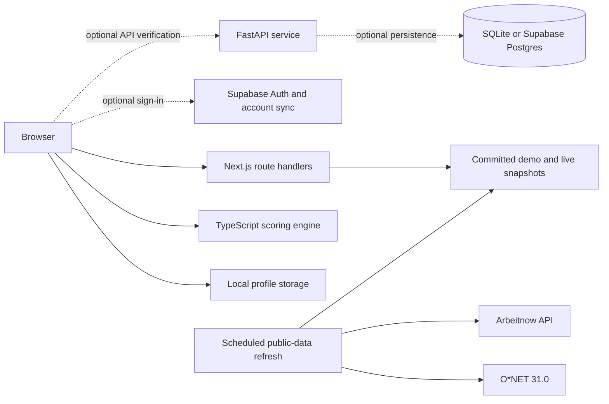

# System architecture

This overview shows how the deployed web application, optional services and data refresh process fit together.

Vercel deploys the Next.js application and its route handlers as the public product. The browser runs the deterministic TypeScript engine and stores guest work locally; configured Supabase credentials add sign-in and account saving. FastAPI is an optional, separately deployable implementation of the scoring contract, while the reviewable refresh workflow updates public catalogue and listing snapshots.

The current Vercel layout is described in [deployment/vercel.md](deployment/vercel.md). Detailed backend architecture is available in [English](../backend/docs/architecture.en.md) and the [Chinese source](../backend/docs/architecture.md).
